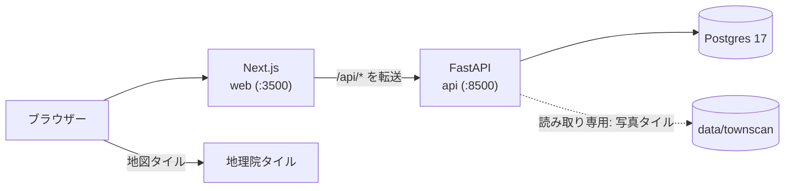
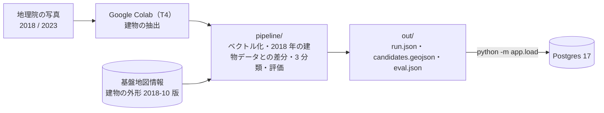

# TownScan

[](https://github.com/Starlight-Tree/TownScan/actions/workflows/ci.yml)

[English](README.md) | 日本語

熊本市の中心部で、2 時点（2018 年・2023 年）の空中写真から新築の候補を見つけ、件数・地図・検出画像を根拠にして、会話で答えるアプリ「TownScan」です（FastAPI、Next.js、Postgres 17、Docker Compose。建物の抽出モデルは Google Colab で実行）。
ローカルで動くたたき台で、公開はしていません。答えは、既定ではツールを呼ぶ模擬モデル（固定の返答）が返します（任意で Gemini も選べます）。画面に出る精度は実測値で、低い値です（「機能」を参照）。

| 地図の上の候補 | 1 件の 2018 年と 2023 年の写真 |
|---|---|
| <a href="docs/images/map.png"><picture><source media="(prefers-color-scheme: dark)" srcset="docs/images/map-dark.png"></picture></a> | <a href="docs/images/compare.png"><picture><source media="(prefers-color-scheme: dark)" srcset="docs/images/compare-dark.png"></picture></a> |

## 機能

- **ツールの結果だけを根拠にするチャット。** 件数・面積・座標は、ツールの結果（候補の一覧、地区ごとの件数、地図、画像の切り出し）だけから出し、モデルの文章では書きません。データの範囲外の質問は断ります。モデルは既定で模擬です。`LLM_PROVIDER=gemini` で、Gemini（Google AI Studio の無料キーを自分で用意します。置き場は下の「秘密の置き場」）も選べます。Gemini が決めるのはツールの選択と説明文だけで、ツールの結果に無い数字を含む返答は、安全なテンプレートに替わります。
- **差分から出す、新築候補の 3 分類。** 2023 年の建物の外形のうち、2018 年の建物データに無いものを、2018 年の写真で確かめます。`confirmed_new`（2018 年に何も無い）・`existing_omission`（2018 年の写真に既にある。建物データの描き漏れ）・`uncertain`（判定保留）。差分は入口で、確かめるのは写真です。画面では「新規出現（旧写真に無い）」「既存の描き漏れ（旧写真に既にある）」「判定保留」と呼び、色・線・形で区別します。
- **地図と、写真の見比べ。** 候補を地理院タイル（標準地図・2018 年の写真・2023 年の写真）の上に描きます。写真の比較（結果領域のタブ。地図・グラフと並ぶ）で、1 棟の 2018 年と 2023 年の切り出しを並べ、根拠の数字を出します。
- **限界を隠さない精度ページ。** 建物の抽出を、2018 年の建物データを参照にして、画素 IoU と物体単位 F1 で測っています。調整用と評価用のタイルを分けて報告します（選んだ設定での評価用の物体単位 F1 は約 0.16。閾値は未検証の初期値）。いまの実行では、確かめた既存の建物のうち約 3 割（200 棟中 66 棟）を、2018 年の抽出が何も見ていないので、既存の建物が「新規出現」に混ざる向きの偏りがあります。新築の再現率は、手ラベルが無いので「未測定」と明示しています。
- **合成データと実データを取り違えない。** 実行ごとに種別（`real`・`synthetic`）を記録し、合成のテスト用データのときは、画面にバナーを出します。
- **任意のログイン（JobNavi・DocuNavi と同じ）。** サイドバー、プロフィールアイコンつきのアカウントのメニュー、Better Auth による Google ログイン（JWT は API が検証）は、ほかの 2 つのアプリと同じ作りです。ログインしなくても、すべての機能を使えます。

## 構成



データは、必要なときに流すオフラインの処理（pipeline）で作ります。



ブラウザーは同じオリジンの `/api/*` だけを呼び、web のコンテナが API へ転送します（転送先は実行時の環境変数 `API_URL`）。ポートは `127.0.0.1` だけに公開し、DB は公開しません。pipeline と API の間のデータの契約は [docs/spec-prototype.md](docs/spec-prototype.md) です。

## クイックスタート

ホストで実行します（Docker と Node 24 が要ります）。

```bash
scripts/dev-up.sh    # 初回は .env を作り（乱数の DB パスワード）、frontend をビルドして、db・api・web を起動する
```

- 画面: <http://127.0.0.1:3500>、API の仕様: <http://127.0.0.1:8500/api/docs>
- このスクリプトは何度流しても同じです。`data/townscan/run1/out/run.json` があれば実データを DB へ読み込み、無ければ読み込みを飛ばします。`data/` は Git に入れていない（写真と建物データは再配布しない）ので、クローンしただけでは候補は空です。実行に必要なファイルは [docs/spec-prototype.md](docs/spec-prototype.md) §4.1 にあり、`python -m pipeline.run_postprocess` が Colab の出力から作ります。
- 止める: `docker compose down`。DB ごと消すとき: `docker compose down -v`。
- Google ログインには、Google Cloud Console で自分で作る OAuth クライアント（種類: ウェブ）が要ります。リダイレクト URI は `http://localhost:3500/api/auth/callback/google` です。ログインを試すときは <http://localhost:3500> で開いてください（`127.0.0.1` では戻れません）。Cookie はホストごとなので、`127.0.0.1` で開いて始めると、Google から `localhost` へ戻ったときに state の Cookie が無く、ログインが失敗します。値は Infisical に置きます（次の項目）。Infisical を使わないときは、`GOOGLE_CLIENT_ID` と `GOOGLE_CLIENT_SECRET` を `.env`（Git の管理外）に書きます。そのとき `BETTER_AUTH_SECRET` は `scripts/dev-up.sh` が `.env` に 1 回だけ作ります。**`BETTER_AUTH_SECRET` は、一度決めたら変えないでください**（DB にある署名鍵の暗号化に使っていて、変えると全員がログアウトに見えます）。Google の値が無いときは、ログインのボタンを押すと「Google でのログインは、まだ設定されていません」と出て、ほかの機能は使えます。
- **秘密の置き場。** JobNavi・DocuNavi と同じく、秘密（`GOOGLE_CLIENT_ID`・`GOOGLE_CLIENT_SECRET`・`BETTER_AUTH_SECRET`、任意の `GEMINI_API_KEY`）は Infisical に置きます（[ADR 0004](docs/decisions/0004-secrets-infisical.md)）。`townscan` プロジェクトを作り、`scripts/login-secrets.sh <Infisical のプロジェクト ID> --from-json <ダウンロードした OAuth クライアントの JSON>` で登録します。クライアント ID とシークレットは、JSON から Python のプロセスの中だけで取り出して表示しません。Gemini のキーは画面に出さずに入力します（空のままなら登録しません。Gemini を使うには、`.env` に `LLM_PROVIDER=gemini` も足します。設定は登録しないので、足さないと模擬のままです）。`BETTER_AUTH_SECRET` はその場で 1 回だけ作り、作り直しません。JSON は、登録に成功したときだけ削除します（`--from-json` を付けないときは、クライアント ID とシークレットを画面に出さずに入力します）。起動は `TOWNSCAN_INFISICAL_PROJECT_ID=<ID> scripts/dev-up.sh` で、中で `infisical run --projectId <ID> --env dev -- docker compose up -d --build` を流します（そのあとに素の `docker compose up -d` で作り直すと、値が空になります）。この環境変数が無いときは、従来どおり `.env` を読みます。Infisical を使うときも、`.env` に置くのは DB のパスワードと、秘密でない設定だけです。Infisical の CLI はホストにあり、開発コンテナにはまだありません。

検査: `scripts/verify.sh [repo|pipeline|backend|frontend|all]`。`backend` は使い捨ての Postgres（Docker が要る）で `pytest` を流し、frontend の重い処理（`npm ci`・型検査・テスト・`next build`）は、Docker VM の空きメモリーが少ないので、ホストの Node 24 で流します。

## 文書

文書は日本語です。

| 文書 | 内容 |
|---|---|
| [docs/plan.md](docs/plan.md) | 計画・段階・出口条件・決定待ち |
| [docs/spec-prototype.md](docs/spec-prototype.md) | たたき台の契約: データのファイル・DB・API・3 分類・評価・画面・出口条件 |
| [docs/decisions/](docs/decisions/) | 決定とその理由: データの候補と規約（0001）、方向（0002）、チャットの LLM（0003）、秘密の置き場（0004） |
| [frontend/README.md](frontend/README.md) | 画面: 動かし方・検査・ログイン |
| [backend/README.md](backend/README.md) | API: 動かし方・テスト・入口 |
| [CLAUDE.md](CLAUDE.md) | 開発の規約（AI エージェント向け） |

## このリポジトリについて

ポートフォリオとして公開している個人のプロジェクトです。次のことを試すために作りました: 限界を隠さずに評価する画像認識、数字を自分では書けないチャット、検出を写真で確かめる地図の画面。秘密は含みません（`.env` は Git の管理外で、コミットしているのは `.env.example` だけ）。パターンによる秘密の検査は、完全な保証ではありません。

データ: 写真は国土地理院のタイル（出典は画面に表示）、参照の建物は国土地理院の基盤地図情報、モデルは `giswqs/whu-building-unetplusplus-efficientnet-b4`（Apache-2.0。学習データ WHU の利用条件は未確認）です。どれも、このリポジトリでは再配布しません。詳細は [docs/decisions/0001-data-candidates.md](docs/decisions/0001-data-candidates.md) です。

## ライセンス

[MIT](LICENSE)（このリポジトリのコードに対するものです。上のデータとモデルは、それぞれの規約に従います）
