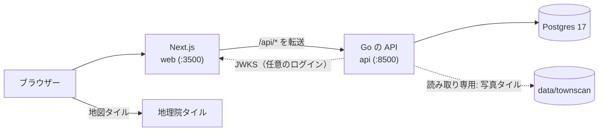
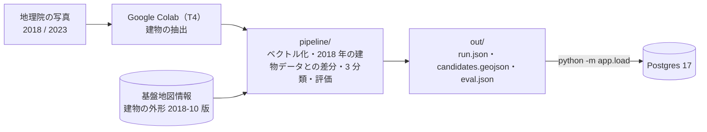

# TownScan

[](https://github.com/Starlight-Tree/TownScan/actions/workflows/ci.yml)

[English](README.md) | 日本語

熊本市の中心部で、2018 年と 2023 年の空中写真から新築の候補を見つけ、件数・地図・写真を根拠に、会話で答えるアプリです。ローカルで動くたたき台（公開はしていません）。Next.js、Go の API（[ADR 0005](docs/decisions/0005-api-in-go.md)）、Postgres 17、建物の抽出モデルは Google Colab で実行します。

| 地図の上の候補 | 1 件の 2018 年と 2023 年の写真 |
|---|---|
| <a href="docs/images/map.png"><picture><source media="(prefers-color-scheme: dark)" srcset="docs/images/map-dark.png"></picture></a> | <a href="docs/images/compare.png"><picture><source media="(prefers-color-scheme: dark)" srcset="docs/images/compare-dark.png"></picture></a> |

## 機能

- **ツールの結果だけを根拠にするチャット。** 件数・面積・座標は、ツールの結果だけから出し、モデルの文章では書きません。範囲外の質問は断ります。既定は模擬モデルで、Gemini も選べます。
- **新築候補の 3 分類。** 2023 年の建物の外形のうち 2018 年の建物データに無いものを、2018 年の写真で確かめます: `confirmed_new`・`existing_omission`・`uncertain`。
- **地図と写真の見比べ。** 候補を地理院タイルの上に描き、1 棟の 2018 年と 2023 年の写真を並べます。
- **限界を隠さない精度ページ。** 評価用の物体単位 F1 は約 0.16 です。新築の再現率は「未測定」と明示しています。
- **任意の Google ログイン。** ログインしなくても、すべての機能を使えます。

## 構成

API は Go（[`api/`](api/README.md)）で作り、解析（画像認識・差分・評価・データの読み込み）は Python のままです。理由は [ADR 0005](docs/decisions/0005-api-in-go.md)。



質問は API のチャットを通ります。規則ベースの模擬モデル（Gemini は任意）がツール（件数・比較・一覧・検出画像）を選び、返答はツールの結果から作ります。数字の検査が、その結果に無い数字を含む返答を、安全な文に差し替えます。

`compose.yaml` は Go の API を動かします。FastAPI 版（`backend/`）は、切り替え中の比較のために残していて、`scripts/dev-up.sh --api python` で使えます（消す予定）。Gemini（`LLM_PROVIDER=gemini`）は Go の API にも入っています。Go の API は同じ契約の検査（`contract/`）に合格し、FastAPI と応答ごとに比べています（`api/difftest/`。検出画像は画素の差）。データの読み込みは Python のままです（`docker compose run --rm loader python -m app.load …`）。

データは、必要なときに流すオフラインの処理で作ります。



### 環境

| 環境 | 構成 | 備考 |
|---|---|---|
| ローカル | `scripts/dev-up.sh`: Docker Compose（db・api・web） | アプリを動かす唯一の環境。写真タイルと建物データは、Git に入れていない `data/` から読みます。 |
| 解析 | Google Colab（T4）と `pipeline/` | 建物の抽出を必要なときに流し、結果は `python -m app.load` で Postgres へ入れます。 |
| 公開 | なし | 公開していません。公開先（計画の P7）は未決です。 |

## クイックスタート

Docker と Node 24 が要ります。

```bash
scripts/dev-up.sh    # frontend をビルドして、db・api・web を起動する
```

- 画面: <http://127.0.0.1:3500> ・ API の仕様（FastAPI 版だけ）: <http://127.0.0.1:8500/api/docs>
- `data/` は Git に入れていない（写真と建物データは再配布しない）ので、クローンしただけでは候補は空です。実行に必要なファイルは [docs/spec-prototype.md](docs/spec-prototype.md) §4.1 にあります。
- 止める: `docker compose down`（DB ごと消すときは `-v`）。検査: `scripts/verify.sh [repo|pipeline|backend|frontend|all]`。
- Google ログインと Gemini のキーは任意で、Infisical に置きます（[ADR 0004](docs/decisions/0004-secrets-infisical.md)）。ログインは <http://localhost:3500> で試します（`127.0.0.1` では戻れません）。`BETTER_AUTH_SECRET` は、一度決めたら変えないでください。

## 文書

文書は日本語です。

| 文書 | 内容 |
|---|---|
| [docs/plan.md](docs/plan.md) | 計画・段階・出口条件・決定待ち |
| [docs/spec-prototype.md](docs/spec-prototype.md) | 契約: データのファイル・DB・API・3 分類・評価・画面 |
| [docs/decisions/](docs/decisions/) | 決定とその理由: データと規約（0001）、方向（0002）、チャットの LLM（0003）、秘密の置き場（0004）、API を Go に（0005） |
| [frontend/README.md](frontend/README.md) ・ [backend/README.md](backend/README.md) | 各部分の動かし方・検査・詳細 |
| [CLAUDE.md](CLAUDE.md) | 開発の規約（AI エージェント向け） |

## このリポジトリについて

ポートフォリオとして公開している個人のプロジェクトです。限界を隠さずに評価する画像認識、数字を自分では書けないチャット、検出を写真で確かめる地図の画面を試すために作りました。秘密は含みません（`.env` は Git の管理外）。

データ: 写真は国土地理院のタイル（出典は画面に表示）、参照の建物は国土地理院の基盤地図情報、モデルは `giswqs/whu-building-unetplusplus-efficientnet-b4`（Apache-2.0。学習データ WHU の利用条件は未確認）です。どれも、このリポジトリでは再配布しません。詳細は [ADR 0001](docs/decisions/0001-data-candidates.md) です。

## ライセンス

[MIT](LICENSE)（コードだけに対するものです。データとモデルは、それぞれの規約に従います）
