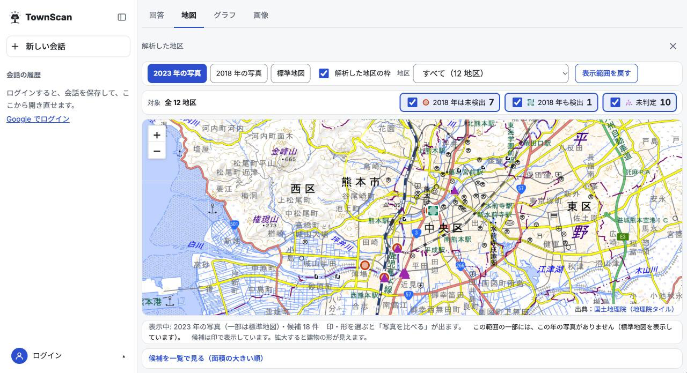
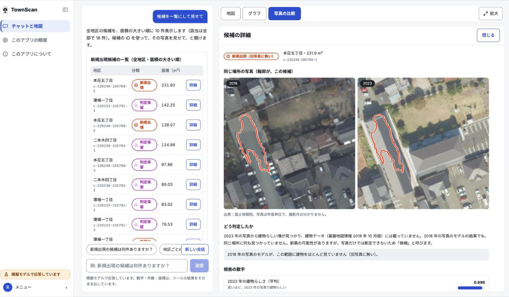
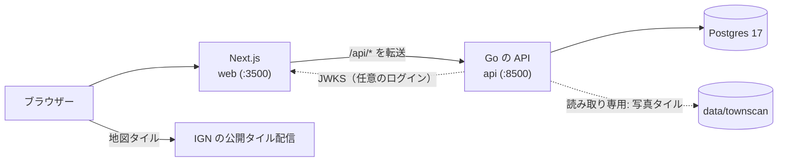
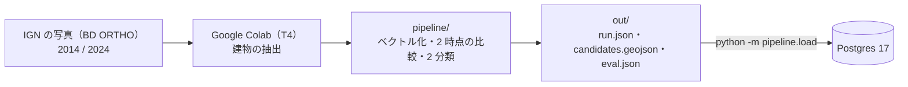

# TownScan

[](https://github.com/Starlight-Tree/TownScan/actions/workflows/ci.yml)

[English](README.md) | 日本語

フランスのパリ南西の近郊で、2014 年と 2024 年の空中写真から新築の候補を見つけ、質問に、短い文と 1 つの表示（写真・グラフ・地図）で答えるアプリです。ローカルで動くたたき台（公開はしていません）。Next.js、Go の API（[ADR 0005](docs/decisions/0005-api-in-go.md)）、Postgres 17、建物の抽出モデルは Google Colab で実行します。

**このアプリの写真（IGN の配信タイル）での検出の精度は、測っていません。** 目で見ると、道路の上を建物と判定した例があり、隣り合う建物が 1 つの大きな形にまとまることもあります。候補の件数は、建築の統計として読めません。別の検証用データで抽出モデルを比べた値は [ADR 0016](docs/decisions/0016-flair-hub-model.md) にあります（調整に使ったデータの値です）。

| 地図の上の候補 | 2014 年と 2024 年の写真つきの回答 |
|---|---|
| <a href="docs/images/map.png"><picture><source media="(prefers-color-scheme: dark)" srcset="docs/images/map-dark.png"></picture></a> | <a href="docs/images/compare.png"><picture><source media="(prefers-color-scheme: dark)" srcset="docs/images/compare-dark.png"></picture></a> |

右の写真は「2014 年は未検出」の中で面積が大きい上位 4 件で、検出の出来を代表する例とは限りません。画像の地図と写真の出典: IGN（フランス国土地理院）の [Plan IGN](https://www.data.gouv.fr/datasets/plan-ign)（最終更新 2026-10-08）と [BD ORTHO](https://www.data.gouv.fr/datasets/bd-ortho-r)（最終更新 2026-11-18）、Licence Ouverte 2.0。

## 機能

- **ツールの結果を根拠にするチャット。** カード・グラフ・地図は、ツールの結果のまま描きます。件数・候補の一覧・写真・精度・お断りの結果 1 件だけの回答は、本文をコードが決めます（[ADR 0013](docs/decisions/0013-one-view-per-answer.md)）。それ以外の本文はモデルが書き、結果に無い数字があれば固定の文に差し替えます（[ADR 0009](docs/decisions/0009-llm-writes-result-numbers.md)）。数字以外の主張は、この検査の外です。範囲外の質問は断ります。モデルは Gemini です（キーが要ります）。
- **新築候補の 2 分類。** 2024 年の写真から取り出した建物の外形を、2014 年の写真と比べます。2014 年でも検出した建物は外し、残りを「2014 年は未検出」（`confirmed_new`）と「未判定」（`uncertain`）に分けます。
- **地図と写真の見比べ。** 候補を IGN の地図と写真の上に描き、1 棟の 2014 年と 2024 年の写真を並べます。
- **限界を隠さない精度ページ。** いまは「未測定」とだけ出し、数字を作りません。抽出の倍率と閾値は固定の値で、このアプリの写真では確かめていません（選び方は [ADR 0016](docs/decisions/0016-flair-hub-model.md)）。
- **任意の Google ログイン。** ログインしなくても使えます。ログインが要るのは、会話の履歴の保存だけです。

## 構成

API は Go（[`api/`](api/README.md)）で作り、解析（画像認識・差分・評価・データの読み込み）は Python のままです。理由は [ADR 0005](docs/decisions/0005-api-in-go.md)。



質問は API のチャットを通ります。Gemini がツール（件数・比較・一覧・検出画像）を選び、カードはツールの結果から作ります。返答の本文は、その結果をもとに Gemini が書きます（件数・一覧・写真・精度・お断りの結果 1 件だけの回答はコードが決めます）。数字の検査が、結果に無い数字を含む返答を、安全な文に差し替えます。

`compose.yaml` は、Go の API を Gemini（既定が `LLM_PROVIDER=gemini`）で動かします。API は契約の検査（`contract/`）で確かめます。データの読み込みは Python です（`docker compose run --rm loader python -m pipeline.load …`）。

データは、必要なときに流すオフラインの処理で作ります。



### 環境

| 環境 | 構成 | 備考 |
|---|---|---|
| ローカル | `scripts/dev-up.sh`: Docker Compose（db・api・web） | アプリを動かす唯一の環境。写真タイルと解析結果は、Git に入れていない `data/` から読みます。 |
| 解析 | Google Colab（T4）と `pipeline/` | 建物の抽出を必要なときに流し、結果は `python -m pipeline.load` で Postgres へ入れます。 |
| 公開 | なし | 公開していません。公開先（計画の P7）は未決です。 |

## クイックスタート

Docker と Node 24 が要ります。

```bash
scripts/dev-up.sh    # frontend をビルドして、db・api・web を起動する
```

- 画面: <http://127.0.0.1:3500>
- `data/` は Git に入れていない（写真は再配布しない）ので、クローンしただけでは候補は空です。実行に必要なファイルは [docs/spec-prototype.md](docs/spec-prototype.md) §4.1 にあります。
- 止める: `docker compose down`（DB ごと消すときは `-v`）。検査: `scripts/verify.sh [repo|pipeline|loader|contract|frontend|all]`。実 Gemini のツール選択の評価は [evals/](evals/README.md) です。
- Gemini の API キー（`GEMINI_API_KEY`）は必須です（既定の設定では、無いと API が起動しません）。Google ログインは任意です。どちらも Infisical（`dev-up.sh` には `TOWNSCAN_INFISICAL_PROJECT_ID` を設定）か `.env` に置きます（[ADR 0004](docs/decisions/0004-secrets-infisical.md)）。ログインは <http://localhost:3500> で試します（`127.0.0.1` では戻れません）。`BETTER_AUTH_SECRET` は、一度決めたら変えないでください。

## 文書

文書は日本語です。

| 文書 | 内容 |
|---|---|
| [docs/plan.md](docs/plan.md) | 計画・段階・出口条件・決定待ち |
| [docs/spec-prototype.md](docs/spec-prototype.md) | 契約: データのファイル・DB・API・3 分類・評価・画面（[改訂の記録](docs/spec-history.md)） |
| [docs/decisions/](docs/decisions/) | 決定とその理由: データと規約（0001）、方向（0002）、チャットの LLM（0003）、秘密の置き場（0004）、API を Go に（0005）、会話の履歴・画面・呼び名（0006〜0013）、新築の再現率（0014）、フランスへの移行（0015）、建物の抽出モデル（0016） |
| [frontend/README.md](frontend/README.md) ・ [api/README.md](api/README.md) | 各部分の動かし方・検査・詳細 |
| [CLAUDE.md](CLAUDE.md) | 開発の規約（AI エージェント向け） |

## このリポジトリについて

ポートフォリオとして公開している個人のプロジェクトです。限界を隠さずに評価する画像認識、返答の数字をツールの結果と照合するチャット、検出を写真で確かめる地図の画面を試すために作りました。秘密は含みません（`.env` は Git の管理外）。

データと出典:

- 写真と地図: [IGN](https://cartes.gouv.fr/cgu/)（フランス国土地理院。BD ORTHO 2014・2024 年と Plan IGN）。Licence Ouverte 2.0。出典は画面に表示します。
- 地区の選び方: [FOTBCD](https://huggingface.co/datasets/abdevd/FOTBCD)（作者: Abdelrrahman Moubane。[CC BY 4.0](https://creativecommons.org/licenses/by/4.0/)。IGN の BD ORTHO・BD TOPO が元）の検証用データで、新築が多い場所を 12 地区選びました。新築の多い場所に偏った標本です。FOTBCD の画像と建物の枠は、アプリに入れていません。
- モデル: IGN の [`IGNF/FLAIR-HUB_LC-A_RGB_swinbase-upernet`](https://huggingface.co/IGNF/FLAIR-HUB_LC-A_RGB_swinbase-upernet)（Licence Ouverte 2.0〔Etalab 2.0〕。最終更新 2026-04-28）。

どれも、このリポジトリでは再配布しません。詳細は [ADR 0015](docs/decisions/0015-move-to-france.md) と [ADR 0016](docs/decisions/0016-flair-hub-model.md) です。

## ライセンス

[MIT](LICENSE)（コードだけに対するものです。データとモデルは、それぞれの規約に従います）
