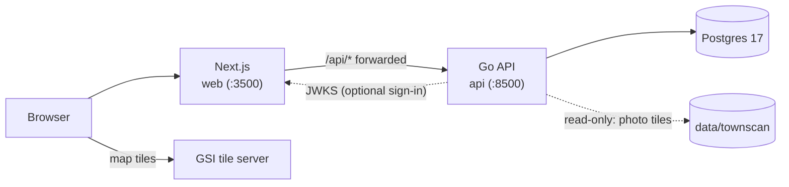

# TownScan

[](https://github.com/Starlight-Tree/TownScan/actions/workflows/ci.yml)

English | [日本語](README.ja.md)

A chat app that finds candidates for new buildings in central Kumamoto City from 2018 and 2023 aerial photos, and answers each question with a short text and one view: photos, a chart or a map. A local prototype (not deployed): Next.js, an API in Go ([ADR 0005](docs/decisions/0005-api-in-go.md)), Postgres 17, and a building-extraction model run on Google Colab.

| Candidates on the map | Photos of one candidate, 2018 and 2023 |
|---|---|
| <a href="docs/images/map.png"><picture><source media="(prefers-color-scheme: dark)" srcset="docs/images/map-dark.png"></picture></a> | <a href="docs/images/compare.png"><picture><source media="(prefers-color-scheme: dark)" srcset="docs/images/compare-dark.png"></picture></a> |

## Features

- **A chat grounded in tool results.** Cards, charts and maps are drawn from the tool results as they are. A count-only reply is worded by code ([ADR 0013](docs/decisions/0013-one-view-per-answer.md)). Other replies are written by the model, and one with a number that is not in the results is replaced with a fixed text ([ADR 0009](docs/decisions/0009-llm-writes-result-numbers.md)); other claims are not checked. Out-of-scope questions are declined. The model is Gemini (an API key is needed).
- **Three classes of candidates.** A 2023 building outline missing from the 2018 building data is checked against the 2018 photo: `confirmed_new`, `existing_omission` or `uncertain`.
- **Map and photo comparison.** Candidates on GSI tiles, and the 2018 and 2023 crops of one building side by side.
- **An accuracy page that shows its limits.** Held-out object F1 is about 0.16; recall for new buildings is "not measured".
- **Optional Google sign-in.** The app works without it; only saved conversation history needs it.

## Architecture

The API is written in Go ([`api/`](api/README.md)); analysis (the image model, diffing, evaluation, data loading) stays in Python. Why: [ADR 0005](docs/decisions/0005-api-in-go.md).



A question goes through the API's chat: Gemini picks a tool (counts, comparison, list, detection image), and the cards are built from the tool's result. Gemini writes the reply text from that result (a count-only reply is worded by code). A number check replaces any reply that contains a figure that is not in the result.

`compose.yaml` runs the Go API with Gemini (`LLM_PROVIDER=gemini` by default). The API is checked by the contract tests (`contract/`). Loading data is done in Python (`docker compose run --rm loader python -m pipeline.load …`).

The data comes from an offline pipeline, run on demand:


### Environments

| Environment | Setup | Notes |
|---|---|---|
| Local | `scripts/dev-up.sh`: Docker Compose (db, api, web) | The only app environment. Photo tiles and building data are read from `data/`, which is not in Git. |
| Analysis | Google Colab (T4) and `pipeline/` | Building extraction runs on demand; the results are loaded into Postgres with `python -m pipeline.load`. |
| Deployed | none | Not deployed. Where to publish (plan stage P7) is not decided. |

## Quick start

Needs Docker and Node 24.

```bash
scripts/dev-up.sh    # builds the frontend and starts db, api and web
```

- App: <http://127.0.0.1:3500>
- `data/` is not in Git (the photos and building data are not redistributed), so a fresh clone starts with no candidates. The files a run needs are in [docs/spec-prototype.md](docs/spec-prototype.md) §4.1.
- Stop: `docker compose down` (add `-v` to delete the DB). Checks: `scripts/verify.sh [repo|pipeline|loader|contract|frontend|all]`.
- A Gemini API key (`GEMINI_API_KEY`) is required: with the default settings the API does not start without it. Google sign-in is optional. Keep both in Infisical (set `TOWNSCAN_INFISICAL_PROJECT_ID` for `dev-up.sh`) or in `.env`: see [ADR 0004](docs/decisions/0004-secrets-infisical.md). Sign in at <http://localhost:3500>, not `127.0.0.1`, and never change `BETTER_AUTH_SECRET` once it is set.

## Documentation

The documents are written in Japanese.

| Document | Contents |
|---|---|
| [docs/plan.md](docs/plan.md) | Plan, stages, exit criteria, pending decisions |
| [docs/spec-prototype.md](docs/spec-prototype.md) | The contract: data files, DB, API, classes, evaluation, UI |
| [docs/decisions/](docs/decisions/) | Decisions and reasons: data and terms (0001), direction (0002), chat LLM (0003), secrets (0004), Go API (0005), conversation history, screens and wording (0006–0013) |
| [frontend/README.md](frontend/README.md) · [api/README.md](api/README.md) | Running, checks and details of each part |
| [CLAUDE.md](CLAUDE.md) | Development conventions (for AI agents) |

## About

A personal portfolio project, built to explore image recognition whose evaluation is honest about its limits, a chat whose numbers are checked against tool results, and a map UI for checking detections against photos. It contains no secrets (`.env` is outside Git).

Data: photos are GSI tiles (the source is shown in the app), reference buildings are GSI Fundamental Geospatial Data, and the model is `giswqs/whu-building-unetplusplus-efficientnet-b4` (Apache-2.0; the terms of its training data, WHU, are unverified). None is redistributed here; see [ADR 0001](docs/decisions/0001-data-candidates.md).

## License

[MIT](LICENSE) (the code only; the data and the model keep their own terms)
