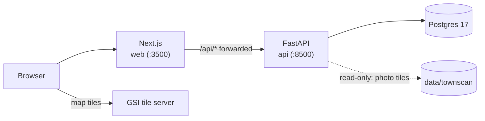
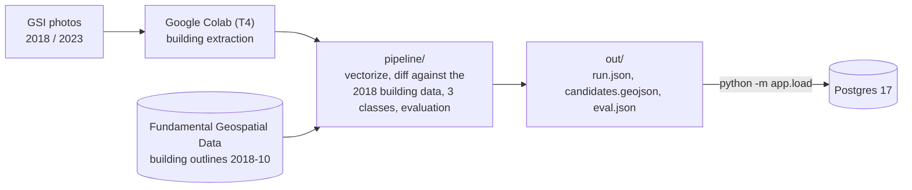

# TownScan

[](https://github.com/Starlight-Tree/TownScan/actions/workflows/ci.yml)

English | [日本語](README.ja.md)

TownScan is a chat app that finds candidates for new buildings in central Kumamoto City from aerial photos of two years (2018 and 2023) and answers questions about them with counts, a map and the detected images (FastAPI, Next.js, Postgres 17, Docker Compose, a building-extraction model run on Google Colab).
It is a local prototype: not deployed, and by default the answers come from a mock model (fixed replies) that calls the tools; Gemini can be chosen instead (optional). The accuracy shown in the app is measured, and it is low (see "Features").

| Candidates on the map | Photos of one candidate, 2018 and 2023 |
|---|---|
| <a href="docs/images/map.png"><picture><source media="(prefers-color-scheme: dark)" srcset="docs/images/map-dark.png"></picture></a> | <a href="docs/images/compare.png"><picture><source media="(prefers-color-scheme: dark)" srcset="docs/images/compare-dark.png"></picture></a> |

## Features

- **Chat that cites its tools.** Counts, areas and coordinates come only from tool results (candidate lists, per-area counts, maps, image crops), never from the model's own text. Questions outside the data are declined. The model is a mock by default. You can choose Gemini (a free Google AI Studio key you provide yourself; see "Where the secrets live" below) with `LLM_PROVIDER=gemini`; it only picks the tools and words the explanation, and any reply with a number that is not in the tool results is replaced by a safe template.
- **Three classes of "new building" candidates, from a difference.** A 2023 building outline that is not in the 2018 building data is checked against the 2018 photo: `confirmed_new` (nothing there in 2018), `existing_omission` (already in the 2018 photo, so the building data missed it) or `uncertain`. The difference is the entry point; the photo decides. The UI calls them "appeared (not in the old photo)", "existing, missing from the data" and "undecided", and tells them apart by colour, line style and shape.
- **Map and side-by-side photos.** Candidates are drawn on Geospatial Information Authority of Japan (GSI) tiles (standard map, 2018 photo, 2023 photo). The "photo comparison" tab of the result area (next to the map and chart tabs) shows the 2018 and 2023 crops of one building with its evidence numbers.
- **An accuracy page that shows its limits.** Building extraction is measured against the 2018 building data with pixel IoU and object-level F1, with the tuning tiles and the held-out tiles reported separately (held-out object F1 is about 0.16 for the chosen setting, and the threshold is an untuned initial value). In the current run, about a third of the existing buildings checked (66 of 200) are invisible to the 2018 extraction, which pushes existing buildings into "appeared". Recall for new buildings is "not measured" because there are no hand labels yet.
- **Synthetic data is never mistaken for real data.** Every run records its kind (`real` or `synthetic`), and the UI shows a banner for synthetic test data.
- **Optional sign-in, same as JobNavi and DocuNavi.** The sidebar, the account menu with the profile icon, and Google sign-in through Better Auth (JWT verified by the API) follow the other two apps. Everything works without signing in.

## Architecture



The data comes from an offline pipeline, run on demand:



The browser only calls the same-origin `/api/*`; the web container forwards it to the API (`API_URL`, read at run time). The ports are published on `127.0.0.1` only and the DB is not published. The data contract between the pipeline and the API is in [docs/spec-prototype.md](docs/spec-prototype.md).

## Quick start

Run these on the host (Docker and Node 24 are needed).

```bash
scripts/dev-up.sh    # creates .env on the first run (random DB password), builds the frontend, starts db / api / web
```

- UI: <http://127.0.0.1:3500>, API docs: <http://127.0.0.1:8500/api/docs>
- The script is safe to run again. It loads a real run into the DB when `data/townscan/run1/out/run.json` exists, and skips the loading when it does not. `data/` is not in Git (the photos and building data are not redistributed), so a fresh clone starts without candidates. The files a run must contain are listed in [docs/spec-prototype.md](docs/spec-prototype.md) §4.1; `python -m pipeline.run_postprocess` builds them from the Colab output.
- Stop: `docker compose down`. To delete the DB as well: `docker compose down -v`.
- Google sign-in needs an OAuth client (type: Web) that you create in Google Cloud Console, with the redirect URI `http://localhost:3500/api/auth/callback/google`. Open the app at <http://localhost:3500> (not `127.0.0.1`) when you try signing in: cookies belong to a host, so the state cookie set on `127.0.0.1` is missing when Google sends you back to `localhost`, and the sign-in fails. The values go in Infisical (next bullet). Without Infisical, put `GOOGLE_CLIENT_ID` and `GOOGLE_CLIENT_SECRET` in `.env` (not in Git); `scripts/dev-up.sh` then generates `BETTER_AUTH_SECRET` there once. **Never change `BETTER_AUTH_SECRET` once it is set**: it encrypts the signing key stored in the DB, and after a change everyone looks logged out. Without the Google values, pressing the sign-in button shows a "not set up yet" message, and the rest of the app still works.
- **Where the secrets live.** As in JobNavi and DocuNavi, the secrets (`GOOGLE_CLIENT_ID`, `GOOGLE_CLIENT_SECRET`, `BETTER_AUTH_SECRET` and the optional `GEMINI_API_KEY`) belong in Infisical ([ADR 0004](docs/decisions/0004-secrets-infisical.md)). Create a `townscan` project and register the values with `scripts/login-secrets.sh <Infisical project ID> --from-json <the OAuth client JSON you downloaded>`: the script takes the client ID and secret out of the JSON inside a Python process without printing them, prompts for the Gemini key without echoing it (leave it empty to skip; to use Gemini, also add `LLM_PROVIDER=gemini` to `.env`, because the setting is not registered and without it the mock stays on), generates `BETTER_AUTH_SECRET` once and never overwrites it, and deletes the JSON only after a successful registration (without `--from-json` it prompts for the client ID and secret instead). Then start with `TOWNSCAN_INFISICAL_PROJECT_ID=<ID> scripts/dev-up.sh`, which runs `infisical run --projectId <ID> --env dev -- docker compose up -d --build` (a plain `docker compose up -d` afterwards would recreate the containers with empty values). Without that variable the script works as before and reads `.env`. `.env` keeps only the DB password and non-secret settings when Infisical is used. The Infisical CLI is on the host; the dev container does not have it yet.

Checks: `scripts/verify.sh [repo|pipeline|backend|frontend|all]`. `backend` runs `pytest` against a throwaway Postgres (Docker is needed), and the heavy frontend steps (`npm ci`, type check, tests, `next build`) run on the host's Node 24 because the Docker VM has little free memory.

## Documentation

The documents are written in Japanese.

| Document | Contents |
|---|---|
| [docs/plan.md](docs/plan.md) | Plan, stages, exit criteria and the decisions still pending |
| [docs/spec-prototype.md](docs/spec-prototype.md) | The prototype's contract: data files, DB, API, the three classes, evaluation, UI, exit criteria |
| [docs/decisions/](docs/decisions/) | Decisions and their reasons: data candidates and terms of use (0001), direction (0002), the chat LLM (0003), where the secrets live (0004) |
| [frontend/README.md](frontend/README.md) | Frontend: running it, checks, the login |
| [backend/README.md](backend/README.md) | Backend: running it, tests, the API |
| [CLAUDE.md](CLAUDE.md) | Development conventions (for AI agents) |

## About this repository

A personal project published as a portfolio, built to explore: image recognition whose evaluation is honest about its limits, a chat that cannot write numbers by itself, and a map UI for checking detections against photos. It contains no secrets (`.env` is outside Git; only `.env.example` is committed). Pattern-based secret checks are not a complete guarantee.

Data: the photos are GSI tiles (the source is shown in the app), the reference buildings are GSI Fundamental Geospatial Data, and the model is `giswqs/whu-building-unetplusplus-efficientnet-b4` (Apache-2.0; the terms of its training data, WHU, are unverified). None of them is redistributed here. Details are in [docs/decisions/0001-data-candidates.md](docs/decisions/0001-data-candidates.md).

## License

[MIT](LICENSE) (the code in this repository; the data and the model above keep their own terms)
