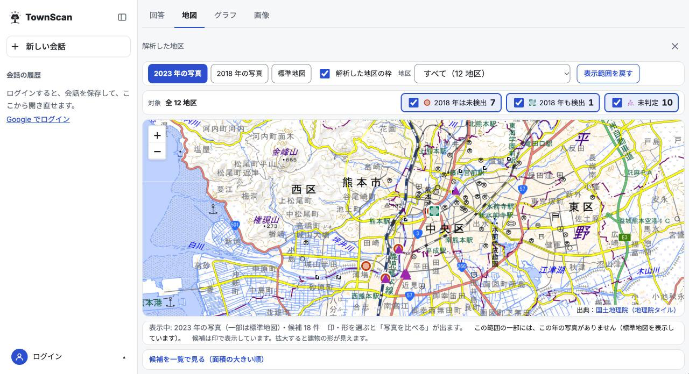
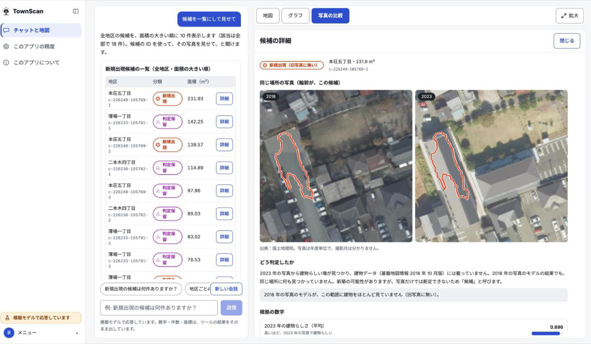
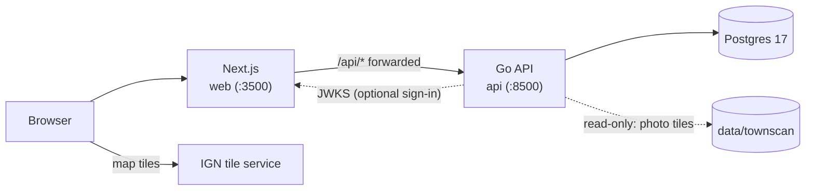
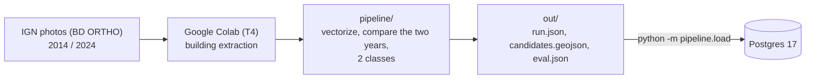

# TownScan

[](https://github.com/Starlight-Tree/TownScan/actions/workflows/ci.yml)

English | [日本語](README.ja.md)

A chat app that finds candidates for new buildings in the south-western suburbs of Paris from 2014 and 2024 aerial photos, and answers each question with a short text and one view: photos, a chart or a map. The app's screens and answers are in Japanese. A local prototype (not deployed): Next.js, an API in Go ([ADR 0005](docs/decisions/0005-api-in-go.md)), Postgres 17, and a building-extraction model run on Google Colab.

**Detection accuracy on this app's photos (IGN tiles) has not been measured.** By eye, there is a case of a road reported as a building, and neighbouring buildings can merge into one large shape. Do not read the candidate counts as construction statistics. A comparison of the extraction models on a separate validation set is in [ADR 0016](docs/decisions/0016-flair-hub-model.md) (values on data that was also used for tuning).

| Candidates on the map | A chat answer with 2014 and 2024 photos |
|---|---|
| <a href="docs/images/map.png"><picture><source media="(prefers-color-scheme: dark)" srcset="docs/images/map-dark.png"></picture></a> | <a href="docs/images/compare.png"><picture><source media="(prefers-color-scheme: dark)" srcset="docs/images/compare-dark.png"></picture></a> |

The photos on the right are the four largest "not detected in 2014" candidates; they are not necessarily typical of the detection quality. Map and photos in these images: [Plan IGN](https://www.data.gouv.fr/datasets/plan-ign) (last updated 2026-10-08) and [BD ORTHO](https://www.data.gouv.fr/datasets/bd-ortho-r) (last updated 2026-11-18) by IGN, Licence Ouverte 2.0.

## Features

- **A chat grounded in tool results.** Cards, charts and maps are drawn from the tool results as they are. A reply whose only result is a count, a candidate list, one candidate's photos, the accuracy report or a refusal is worded by code ([ADR 0013](docs/decisions/0013-one-view-per-answer.md)). Other replies are written by the model, and one with a number that is not in the results is replaced with a fixed text ([ADR 0009](docs/decisions/0009-llm-writes-result-numbers.md)); other claims are not checked. Out-of-scope questions are declined. The model is Gemini (an API key is needed).
- **Two classes of candidates.** Each building outline extracted from the 2024 photo is checked against the 2014 photo. Buildings also detected in 2014 are dropped; the rest are "not detected in 2014" (`confirmed_new`) or "undecided" (`uncertain`).
- **Map and photo comparison.** Candidates on IGN map and photo tiles, and the 2014 and 2024 crops of one building side by side.
- **An accuracy page that shows its limits.** For now it says "not measured" and shows no numbers. The extraction scale and threshold are fixed values that have not been checked on this app's photos (how they were chosen: [ADR 0016](docs/decisions/0016-flair-hub-model.md)).
- **Optional Google sign-in.** The app works without it; only saved conversation history needs it.

## Architecture

The API is written in Go ([`api/`](api/README.md)); analysis (the image model, diffing, evaluation, data loading) stays in Python. Why: [ADR 0005](docs/decisions/0005-api-in-go.md).



A question goes through the API's chat: Gemini picks a tool (counts, comparison, list, detection image), and the cards are built from the tool's result. Gemini writes the reply text from that result (replies with a single count, list, photo, accuracy or refusal result are worded by code). A number check replaces any reply that contains a figure that is not in the result.

`compose.yaml` runs the Go API with Gemini (`LLM_PROVIDER=gemini` by default). The API is checked by the contract tests (`contract/`). Loading data is done in Python (`docker compose run --rm loader python -m pipeline.load …`).

The data comes from an offline pipeline, run on demand:



### Environments

| Environment | Setup | Notes |
|---|---|---|
| Local | `scripts/dev-up.sh`: Docker Compose (db, api, web) | The only app environment. Photo tiles and analysis results are read from `data/`, which is not in Git. |
| Analysis | Google Colab (T4) and `pipeline/` | Building extraction runs on demand; the results are loaded into Postgres with `python -m pipeline.load`. |
| Deployed | none | Not deployed. Where to publish (plan stage P7) is not decided. |

## Quick start

Needs Docker and Node 24.

```bash
scripts/dev-up.sh    # builds the frontend and starts db, api and web
```

- App: <http://127.0.0.1:3500>
- `data/` is not in Git (the photos are not redistributed), so a fresh clone starts with no candidates. The files a run needs are in [docs/spec-prototype.md](docs/spec-prototype.md) §4.1.
- Stop: `docker compose down` (add `-v` to delete the DB). Checks: `scripts/verify.sh [repo|pipeline|loader|contract|frontend|all]`. The eval of which tool real Gemini picks is in [evals/](evals/README.md).
- A Gemini API key (`GEMINI_API_KEY`) is required: with the default settings the API does not start without it. Google sign-in is optional. Keep both in Infisical (set `TOWNSCAN_INFISICAL_PROJECT_ID` for `dev-up.sh`) or in `.env`: see [ADR 0004](docs/decisions/0004-secrets-infisical.md). Sign in at <http://localhost:3500>, not `127.0.0.1`, and never change `BETTER_AUTH_SECRET` once it is set.

## Documentation

The documents are written in Japanese.

| Document | Contents |
|---|---|
| [docs/plan.md](docs/plan.md) | Plan, stages, exit criteria, pending decisions |
| [docs/spec-prototype.md](docs/spec-prototype.md) | The contract: data files, DB, API, classes, evaluation, UI ([revision log](docs/spec-history.md)) |
| [docs/decisions/](docs/decisions/) | Decisions and reasons: data and terms (0001), direction (0002), chat LLM (0003), secrets (0004), Go API (0005), conversation history, screens and wording (0006–0013), new-building recall (0014), the move to France (0015), the extraction model (0016) |
| [frontend/README.md](frontend/README.md) · [api/README.md](api/README.md) | Running, checks and details of each part |
| [CLAUDE.md](CLAUDE.md) | Development conventions (for AI agents) |

## About

A personal portfolio project, built to explore image recognition whose evaluation is honest about its limits, a chat whose numbers are checked against tool results, and a map UI for checking detections against photos. It contains no secrets (`.env` is outside Git).

Data and attribution:

- Photos and maps: [IGN](https://cartes.gouv.fr/cgu/) (BD ORTHO 2014 and 2024, Plan IGN), Licence Ouverte 2.0. The source is shown in the app.
- Area selection: the 12 areas were chosen where the validation split of [FOTBCD](https://huggingface.co/datasets/abdevd/FOTBCD) (by Abdelrrahman Moubane, [CC BY 4.0](https://creativecommons.org/licenses/by/4.0/), built from IGN BD ORTHO and BD TOPO) has the most new buildings. This is a deliberately high-construction sample. FOTBCD images and labels are not part of the app.
- Model: [`IGNF/FLAIR-HUB_LC-A_RGB_swinbase-upernet`](https://huggingface.co/IGNF/FLAIR-HUB_LC-A_RGB_swinbase-upernet) by IGN (Licence Ouverte 2.0 / Etalab 2.0, last updated 2026-04-28).

None of these is redistributed here; see [ADR 0015](docs/decisions/0015-move-to-france.md) and [ADR 0016](docs/decisions/0016-flair-hub-model.md).

## License

[MIT](LICENSE) (the code only; the data and the model keep their own terms)
